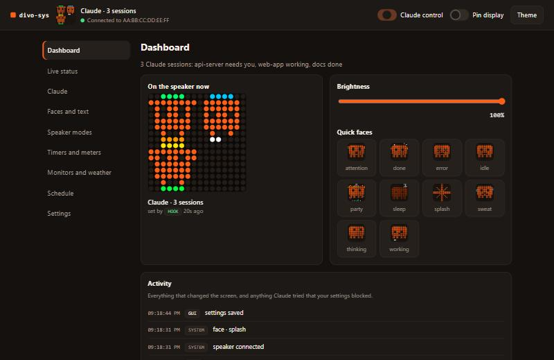
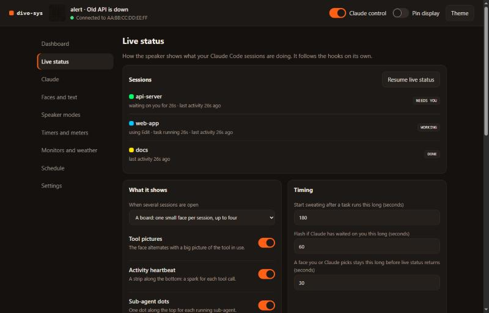
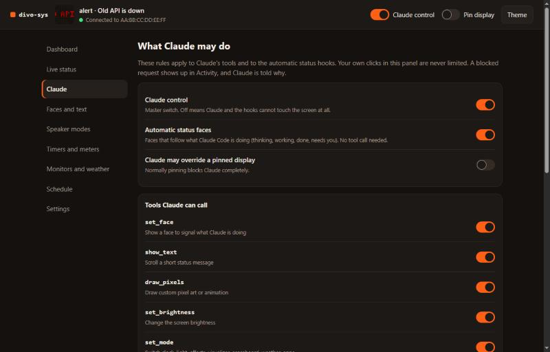
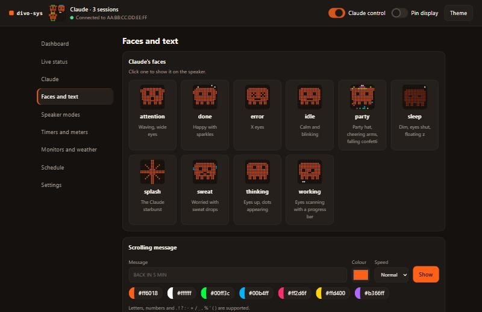
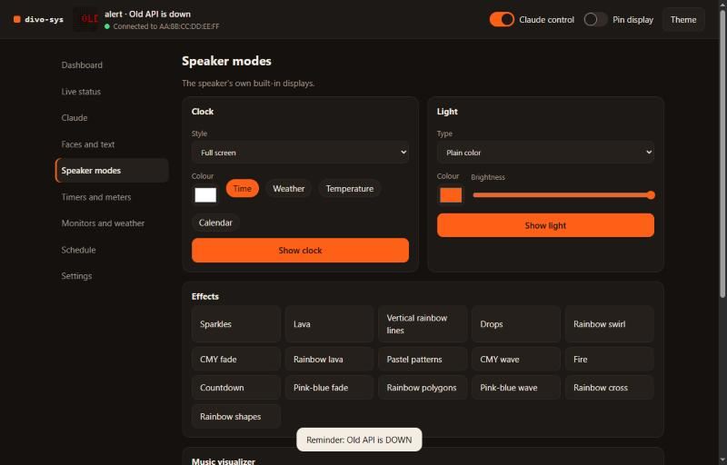
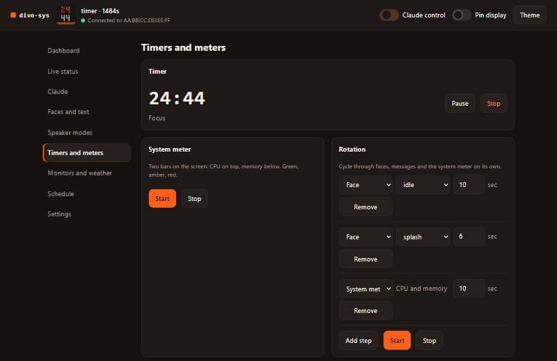
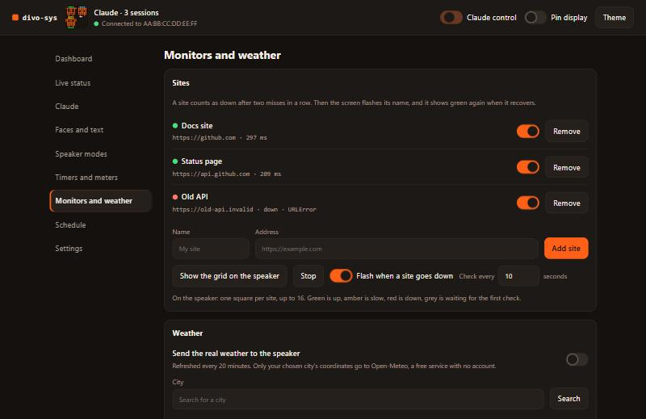

# divo-sys

**Put Claude Code's status on a Divoom Timebox Evo.** A 16×16 LED speaker becomes a small status light for your AI
coding sessions: a pixel face in Claude's orange that thinks, works, waves when it needs you, and celebrates when it
finishes. A local control panel lets you decide exactly what Claude is allowed to do on it.

Windows, Python 3.9+, **no third-party packages**. No cloud, no account: everything runs on your machine.



## What it does

- **Shows what Claude is doing, live.** Thinking, working (with a picture of the tool in use), waiting on you, done,
  failed. One face for one session, a small board of faces when several are open.
- **Lets you set the rules.** Claude's tools and hooks go through a permission layer you control: a master switch, a
  switch per tool and per face, rate limits, quiet hours, and a Pin that locks the screen.
- **Does more than status.** Timers with a progress bar, a CPU/RAM meter, a network latency graph, battery and disk
  bars, site uptime monitoring, real weather, reminders, night dimming, and the speaker's own clock, light, effects,
  visualizer and scoreboard.
- **Stays out of the way.** One background service holds the Bluetooth link, restarts itself, and starts with Windows.

## Install

You need a Timebox Evo (or another Divoom speaker that speaks the same protocol, untested) paired in Windows
Bluetooth settings, and **Python 3.9 or newer on your PATH** (in the python.org installer, tick "Add python.exe to
PATH"). Close the Divoom phone app: the speaker takes one controller at a time.

**With the installer (easiest).** Download `divo-sys-setup.exe` from the
[latest release](https://github.com/haithamexe/divo-sys/releases/latest) and double-click it. It asks once, then
installs divo-sys as a real Windows app (listed as "divo-sys" in Startup apps and Installed apps, not as "Python"),
finds your speaker, starts with Windows in the background, adds the Claude Code hooks and MCP server, puts an icon on
your desktop, and opens the panel. Restart Claude Code afterwards. To update, run a newer setup file; it keeps your
settings.

The file is not code-signed (that costs money), so Windows SmartScreen may say "unknown publisher": choose
**More info, Run anyway**. To check what you downloaded, compare it with the `.sha256` file next to it:
`certutil -hashfile divo-sys-setup.exe SHA256`.

**From source.**

```
git clone https://github.com/haithamexe/divo-sys.git
cd divo-sys
python divo.py setup
```

This does the same thing, building the app on your own machine. Then open the panel with the desktop icon, or:

```
python divo.py gui
```

**No speaker yet?** `python divo.py demo` opens the full panel against a pretend speaker with sample sessions.

Details, troubleshooting and manual setup: [docs/setup.md](docs/setup.md). To remove it: **Settings, Apps, Installed
apps, divo-sys, Uninstall**, or `python divo.py uninstall`.

## The panel

| | |
| --- | --- |
|  **Live status.** Your open sessions, what each is doing, and which overlays to show. |  **Claude.** The master switch, the tools and faces Claude may use, limits, quiet hours. |
|  **Faces and text.** Ten faces, scrolling messages in any colour. |  **Speaker modes.** The speaker's own clock, light, effects, visualizer, scoreboard. |
|  **Timers and meters.** Countdown and stopwatch, CPU/RAM, network, battery and disk. |  **Monitors and weather.** Site uptime with alerts, real weather for your city. |

## Reading the screen

| You see | It means |
| --- | --- |
| Thinking face, dots growing | You sent a prompt; Claude is reasoning |
| Working face alternating with a big picture | The tool in use: `>_` terminal, pencil, eyes for Read, magnifier, globe, flask for tests, a branch for git |
| Strip along the bottom | Activity heartbeat: a spark per tool call, one column per 5 seconds |
| Dots at the top left | Running sub-agents |
| Square at the top right | The build after a `git push`: amber running, green passed, red failed |
| Hopping and waving, with yellow sparkles | Claude is waiting on you |
| Cheering face with sparkles | Done |
| Party hat and confetti | A push went through or tests ran. A big number over a bar shows test results |
| Glitch | A tool failed |
| Four small faces | Several sessions are open, each with its own colour stripe |

The full guide, with every option: [docs/live-status.md](docs/live-status.md).

## Claude's side

Two paths, both through the same permission checks:

- **Hooks** make the screen follow Claude Code automatically. Nothing for Claude to call.
- **MCP tools** (`set_face`, `show_text`, `draw_pixels`, `set_brightness`, `set_mode`, `timer`, `divoom_status`)
  let Claude choose what to show. If you block something, Claude is told why and does not keep retrying.

## Commands

```
python divo.py setup | uninstall     install or remove the app, hooks, MCP server, startup and icon
python divo.py build-installer       build divo-sys-setup.exe to give to other people
python divo.py gui                   open the panel
python divo.py shortcut              put a divo-sys icon on the desktop (or: startmenu, remove)
python divo.py demo                  try it without a speaker
python divo.py discover              list paired Divoom speakers and their Bluetooth addresses
python divo.py start | stop          run or stop the background service
python divo.py face <mood>           idle thinking working done attention error sleep splash party sweat
python divo.py text HELLO            scroll a message
python divo.py status                what is connected and showing
```

## Fork ZERO (GallardoGH/divo-sys-openclaw)

- **Night light (luz nocturna)**: \divo nightlight on|off|enable|disable\ + tarjeta "Luz nocturna" en el panel. Franja horaria o permanente, color/estilo/brillo/fundido configurables (\settings.nightlight\), cero trafico BT mientras dura y pausa caras/escena; al salir de la franja vuelve sleep (noche) o idle.
- Ramas: \main\ = estable (la usa el runtime), \DESTROYER\ = desarrollo del fork.

Our changes on top of upstream:

- **ZERO faces** (`divosys/zerofaces.py`, override block at the end of `faces.py`): the whole Claude-brand set is replaced by our design — two 4x4 white eyes with a **2x2 pupil whose colour marks the mood** (cyan calm · amber thinking/attention · red error/anger · green done/happy · magenta hearts/party · blue sweat) and an expressive mouth below (grin, frown, zig-zag, yawn, tongue, smirk, open-O). New moods added: `happy, angry, wink, bored, tease, surprise, heart` (17 in total). Revert by deleting the override block; the original `_build()` stays untouched.
- **Spanish UI (es-ES)**: panel strings (`web/index.html`, original kept as `index.html.en`), mood/tool descriptions (`server.py`) and clock styles (`protocol.py`).
- Tests in `test_live.py`/`test_app.py`/`test_shortcut.py` updated to assert OUR design invariants (pupil colours, mouth bands, icon pixels) instead of the brand ones.
- After editing Python sources, rebuild the app exe (`python divo.py install`) and restart the daemon — the running `divo-sys.exe` embeds a copy of the code.

## How it works

| File | Role |
| --- | --- |
| `divosys/protocol.py` | The Timebox Evo wire format over Bluetooth RFCOMM (standard-library `socket`) |
| `divosys/engine.py` | Owns what the screen shows; coalesces requests, tracks sessions, runs timers and apps, reconnects |
| `divosys/scene.py`, `faces.py` | Turn sessions into frames: faces, glyphs, board, overlays, meters |
| `divosys/policy.py` | The permission rules, as a pure function |
| `divosys/server.py` | Localhost HTTP: the panel and its JSON API |
| `divosys/hook.py`, `mcp_server.py` | The Claude Code hook script and the stdio MCP server |
| `divosys/monitors.py` | Site checks, GitHub Actions watcher, weather, latency probe |
| `divosys/appinstall.py`, `launch.py` | Builds and installs `divo-sys.exe` (the program in one file, with its own name and icon) |
| `divosys/setup_cmd.py`, `discover.py`, `cli.py` | One-step install, speaker discovery, the command line |

The speaker drops its Bluetooth link if flooded, so only the newest picture is ever sent: requests are coalesced into
one slot instead of queued.

## Privacy and security

The service listens on `127.0.0.1` only and, apart from the opt-in features below, never contacts anything. The
permission switches are **guardrails on the tools this project exposes, not a sandbox**: anything running as you can
read the panel's token. Read [docs/security.md](docs/security.md) for the threat model and the honest limits.

Opt-in network use: sites you list under Monitors, GitHub (through your own `gh` login, only after a `git push`),
Open-Meteo for weather if you switch it on, and `1.1.1.1:443` while the latency graph is running.

## Development

```
python -m unittest discover -s tests
```

The tests need no speaker and no network. See [CONTRIBUTING.md](CONTRIBUTING.md).

## Limits

- Windows is the supported platform. Linux should work with a paired speaker and its address; macOS has no RFCOMM
  sockets in Python, so it can only run the panel (try `demo`).
- The music visualizer's eleven styles are numbered, not named (the protocol does not name them).
- The speaker loops animations it is sent, so live parts (heartbeat, clock) refresh about every 5 seconds.
- The build dot needs the GitHub CLI (`gh`) signed in.
- Uploading your own art and a community gallery are intentionally not included.

## Changes

See [CHANGELOG.md](CHANGELOG.md).

## Credits and license

The Timebox Evo protocol notes come from the reverse-engineering work in
[RomRider/node-divoom-timebox-evo](https://github.com/RomRider/node-divoom-timebox-evo); the pixel packing here is
unit-tested against a port of that library's algorithm. Not affiliated with Divoom or Anthropic.

[MIT](LICENSE)

